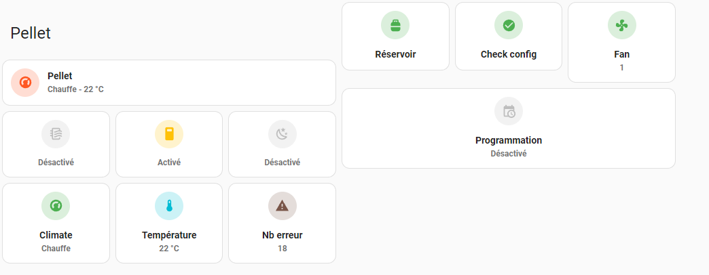

# Edilkamin for Home Assistant

[](https://github.com/algra4/ha-edilkamin/actions/workflows/tests.yml)
[](https://github.com/algra4/ha-edilkamin/actions/workflows/dependabot/dependabot-updates)
[](https://github.com/algra4/ha-edilkamin/actions/workflows/github-code-scanning/codeql)


- [Edilkamin for Home Assistant](#edilkamin-for-home-assistant)
  - [Available sensors](#available-sensors)
    - [Binary sensors](#binary-sensors)
    - [Climate](#climate)
    - [Fan](#fan)
    - [Sensors](#sensors)
    - [Switches](#switches)
  - [Installation](#installation)
    - [Installation via HACS (recommended)](#installation-via-hacs-recommended)
  - [Automations](#automations)
    - [Send notification when the tank is empty](#send-notification-when-the-tank-is-empty)
  - [Send notification whe the tank has been refill](#send-notification-whe-the-tank-has-been-refill)
  - [Tested device](#tested-device)
  - [External dependencies](#external-dependencies)
  - [Thanks](#thanks)
  - [Development notes](#development-notes)





> [!WARNING]  
> If the API changes, I can't guarantee that the integration will continue to work.

## Available sensors

### Binary sensors

| Name    | Description |
| -------- | ------- |
| `Check configuration`  | Check if the pellet stove is available via api   |
| `Tank`  | Give the information if the pellet stove must be refill or not   |

### Climate

The climate entity is able to:
- select the target temperature
- switch the mode
  - off
  - heat
- select the preset
  - auto
  - manual p1
  - manual p2
  - manual p3
  - manual p4
  - manual p5
- control the main fan

### Fan
The Integration creates the number of fans depending on the pellet stove

| Name    | Description |
| -------- | ------- |
| `Fan ${index}`  |  Manage the fan   |

### Sensors

| Name    | Description | Unit
| -------- | ------- | ------- |
| `Temperature`  |  The actual temperature   | celsius |
| `Buffer temperature` | Buffer tank water temperature, when reported by the stove | celsius |
| `Boiler temperature` | Boiler water temperature, when reported by the stove | celsius |
| `Fan ${index}`  |  The fan speed  | int |
| `Nb alarms`  |  The number of alarms | int |
| `Actual power`  |  The pover of the pellet stove | int |
| `Operational phase`  |  The phase of the pellet stove | Off, Ignition, On, Shutdown, Cooling, Alarm, Final cleaning, Unknown |
| `Autonomy`  |  Time remaining before the pellet stove turns off if no pellets are added | minute |
| `Power ons`  |  Number of times the pellet stove has been turn on | int |
| `Daily schedule` | Today's programmed chrono slots; state is `enabled` or `disabled` | enum |
| `P1 working hours` ... `P5 working hours` | Lifetime working time at each power level | h |
| `Total working hours` | Sum of all five lifetime working-time counters | h |

Working hours come from `nvm.total_counters.p1_working_time` through
`p5_working_time`, without conversion. The hour unit was checked against the
physical remote control of a Pellkamin 10 evo plus; other models have not been
independently verified. These duration sensors use `total_increasing` because
they accumulate operating time; Home Assistant treats a decrease as a new meter
cycle. Missing or invalid counters make the affected sensor unavailable, never
zero. The total requires all five counters, including explicitly reported zeros.
The total covers P1-P5 working time, not necessarily every operating phase.
Resettable `nvm.service_counters` are deliberately not used or exposed: they must
not be mixed with lifetime hours, and their reset semantics need separate validation.

#### Daily schedule

The read-only `Daily schedule` sensor exposes the stove's programmed day for dashboards
and templates. It reuses the existing coordinator data and does not make extra cloud
requests or change the stove's program. If the selected weekly schedule is absent or
malformed, or the cloud update fails, the sensor is unavailable rather than showing an
empty/off program. Devices without chrono data therefore expose an unavailable sensor.

Attributes:

| Attribute | Meaning |
| --------- | ------- |
| `date` | Day represented, as `YYYY-MM-DD` in Home Assistant's configured time zone |
| `timezone` | Home Assistant's configured time zone |
| `slots` | 48 half-hour values: index 0 is 00:00–00:30, index 1 is 00:30–01:00, …, index 47 is 23:30–24:00 |
| `periods` | Consecutive equal slots grouped as `{start, end, mode}`; local `HH:MM` times from `00:00` to `24:00` |
| `chrono_active` | Whether the stove's chrono program is enabled |
| `is_auto` | `true` selects `temperature_ranges`; `false` selects `power_ranges` |
| `economy_temperature` | Programmed Economy setpoint, if reported by the stove |
| `comfort_temperature` | Programmed Comfort setpoint, if reported by the stove |

In automatic mode, slot values are `0` (off), `1` (Economy), and `2` (Comfort).
In manual mode, values are `0` (off) and `1`–`5` (power levels). The source weekly
arrays are ordered Monday through Sunday, with 48 values per day. Disabling chrono
retains the programmed slots for inspection; it does not erase them. The day switches
on the next coordinator update after local midnight (normally within 15 seconds).
Slots represent wall-clock half-hours, so daylight-saving transition days still have
48 entries; they are not a list of 48 unique UTC intervals. A programmed slot describes
the requested schedule, not whether the stove is currently burning or in standby.

`periods` makes the saved on/off times directly readable without converting slot
indexes in dashboard templates. Each period includes its `start` and excludes its
`end`. Boundaries are always whole or half hours, formatted with leading zeros.
The periods cover the full day without gaps or overlaps, including off periods;
the final period ends at `24:00`, not `00:00`. Equal values are merged only when
adjacent, never across midnight or across another mode. Times are wall-clock
labels in `timezone`, not UTC timestamps, including on DST transition days.

Modes are `off`, `economy`, `comfort` in automatic mode and `off`, `power_1`
through `power_5` in manual mode. `chrono_active` remains independent: when chrono
is disabled, both `slots` and `periods` still describe the saved schedule.

For example, a day starting with `[0, 0, 1, 1, 2, 2]` and off for the remaining
42 slots exposes:

```json
[
  {"start": "00:00", "end": "01:00", "mode": "off"},
  {"start": "01:00", "end": "02:00", "mode": "economy"},
  {"start": "02:00", "end": "03:00", "mode": "comfort"},
  {"start": "03:00", "end": "24:00", "mode": "off"}
]
```

Example template listing the saved time ranges (replace the entity ID with yours):

```jinja2

  {{ period.start }}–{{ period.end }}: {{ period.mode }}

```

The raw `slots` attribute remains available. Example current-slot template:

```jinja2


  {{ slots[now().hour * 2 + now().minute // 30] }}

  unavailable

```

### Switches

| Name    | Description |
| -------- | ------- |
| `Airekare`  |  Switch the airekare mode   |
| `Chrono mode` | Switch the chrono mode     |
| `Relax mode`    | Switch the relax mode    |
| `Stand by mode`    | Switch the stand by mode. <br> When the Stand-by function is active, in the automatic and crono modes, the product switches off once the temperature set-point is reached and turns on again when the room temperature drops below the chosen value    |


## Installation

Click on this button:

[](https://my.home-assistant.io/redirect/hacs_repository/?owner=algra4&repository=ha-edilkamin&category=integration)


### Installation via HACS (recommended)
1. Ensure HACS is installed.
1. Add this repo (https://github.com/algra4/ha-edilkamin) has custom repo ([HACS how-to](https://hacs.xyz/docs/faq/custom_repositories))
1. Search for and install the "Edilkamin" integration
2. Restart Home Assistant
3. In the home assistant configuration screen click on Integrations.
4. Click on the + icon to add a new integration.
5. Search for `Edilakmin` and select it.
6. Enter the mac address and your edilkamin username and password.

<details>
  <summary>Manual Installation</summary>
  
  1. Download the latest release.
  2. Extract the files and move the `edilakmin` folder into the path to your custom_components. e.g. /config/custom_components.
  3. Restart Home Assistant
  4. In the home assistant configuration screen click on Integrations.
  5. Click on the + icon to add a new integration.
  6. Search for `Edilakmin` and select it.
  7. Enter the mac address of the pellet stove name and click Submit.
</details>


## Automations

### Send notification when the tank is empty

```yaml
alias: Tank empty
triggers:
  - type: problem
    device_id: f892184070f74cfbf812bb4000cd1c58 # id of the Edilkamindevice
    entity_id: be3da6cdd182ec44f8ac6ba68e28997e # id of the binary_sensor tank 
    domain: binary_sensor
    trigger: device
actions:
  - action: notify.notify
    metadata: {}
    data:
      message: The pellet tank is almost empty, so it's time to feed it.
      title: 🔥 Pellet stove 🔥
mode: single

```

## Send notification whe the tank has been refill

```yaml
alias: Tank full
triggers:
  - type: no_problem
    device_id: f892184070f74cfbf812bb4000cd1c58 # id of the Edilkamindevice
    entity_id: be3da6cdd182ec44f8ac6ba68e28997e # id of the binary_sensor tank 
    domain: binary_sensor
    trigger: device
actions:
  - action: notify.notify
    metadata: {}
    data:
      message: The pellet tank has been filled
      title: 🔥 Pellet stove 🔥
mode: single
```

## Tested device

- Myrna 
  - motherboard : `1.58.201215a` - `1.0.200824a`
  - wifi_ble_module : `1.0_20` - `1.0.200824a`
 
- Blade H
  - platine firmware : `4.1.240802a`
  - core control pan : `4.1.241010a`

## External dependencies

- This project uses the  [edilkamin.py](https://github.com/AndreMiras/edilkamin.py) under MIT licence thanks to @AndreMiras

## Thanks
- thanks to [@nghaye](https://github.com/nghaye/ha-edilkamin) for some inspiration to improve integration

## Development notes

- Home Assistant installs this integration's runtime dependencies from `custom_components/edilkamin/manifest.json` when the integration is loaded.
- For local development and CI, dependencies are managed with `pyproject.toml` and `uv`.
  - Install dev dependencies: `uv sync`
  - Run tests: `uv run pytest -v`
- Linting/formatting uses Ruff (replacing flake8 and isort). Basic commands:
  - Lint: `uv run ruff check .`
  - Format (optional): `uv run ruff format .`


